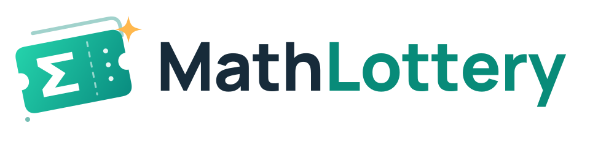
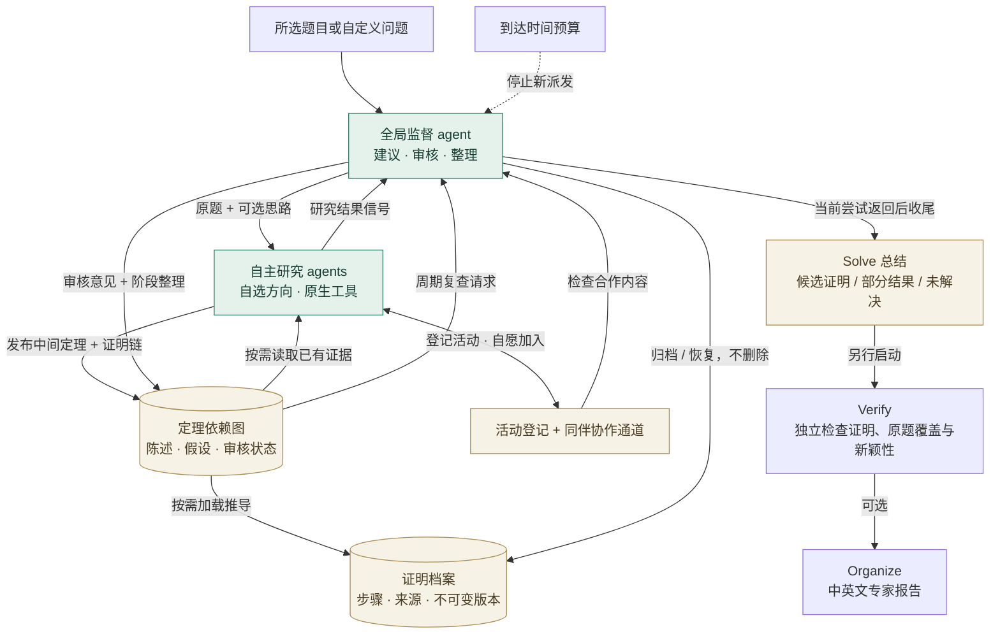

  <picture>
    <source media="(prefers-color-scheme: dark)" srcset="assets/mathlottery-logo-dark.svg">
    
  </picture>

<h2 align="center">Token is all you need.</h2>

  <a href="README.md">English</a> | 简体中文

  <a href="docs/usage.cn.md">安装与使用</a> · <a href="docs/solve-teams.cn.md">监督式 Solve</a> · <a href="showcase/README.cn.md">结果样本</a>

**从一个研究者开始，有余力时一起探索。**

MathLottery 是一个本地数学研究项目：让 agent 自己找公开问题、尝试求解，再检查自己的成果。我们想试试，不是数学专业、也没有大规模算力的普通人，能不能借助 AI 做出一点新的数学结果。

在 **`ai4math` 分支**，Solve 可以采用**全局监督 agent、自主研究 agent、共享证明留言板**的协作模式。监督者提供思路并审核证据，研究者自行选择方向并共享中间成果；Find、独立 Verify 和 Organize 仍是分别启动的步骤。

这个念头来自 OpenAI 公开的一批数学研究成果。OpenAI 称，平均每项结果使用的算力，相当于约三小时 ChatGPT Pro 思考；这些结果由内部模型产生。这个算力对比让人很想亲自试试，即使并不意味着公开的 Pro 模式已经有同样的能力。[来源：OpenAI 数学进展介绍](https://openai.com/index/sharing-ai-progress-in-mathematics/)

我们的目标很朴素：**先让一个 agent 认真探索，争取抽中一份值得验证的数学成果。**

## 我们想做的事情

### 1. 找题：有什么问题值得试？

> 我不是数学专业的，找公开未解决的问题就已经很麻烦了。

那就先问 agent。

让它自己上网找问题，读原始论文和问题列表，核对准确表述、已有进展，以及是否已经有人给出解答。再结合问题规模、可用工具和研究预算，说明为什么值得尝试。

也可以直接交给它一个你关心的问题。从一个小引理开始，或者输入“请你解决哥德巴赫猜想”，研究目标由你决定；选题理由和未解状态需要留下可追溯的来源。

**找题 → 用户选题 → 求解**：比较候选列表的难度、验证与 Lean 可行性，由你决定研究哪一道题。求解会携带所选 Find 的资料与笔记，推荐项不会自动启动求解。

### 2. 求解：监督规划，自主探索，共享证明

> 从一个研究者开始；资源允许时，让多个研究者尝试不同方向。

给它一个问题、一段时间和可用工具，让它自己决定怎么做：查文献、拆分问题、推导引理、写程序、做实验、找反例，走不通就换一条路。

全局监督者接收原题，提供可选思路。**研究者自主选择方向**，可以采纳、调整或拒绝建议，无需请示；在留言板声明正在做的工作，发现重叠后自行决定复用、合作或独立复核。每个研究者保留自己的会话与原生工具，中间定理附带假设、证明步骤和依赖。监督者负责审查具体证据版本、整理成果和提供进一步建议。

留言板将轻量定理依赖图与按需读取的证明档案分开。研究者可登记活动、发现同伴并自愿加入可观察的协作通道；监督者可归档或恢复条目，保留全部证据。详见[证明图谱与协作说明](docs/proof-board.cn.md)。

用户还可选择开启**监督机制优化**：根据实际研究活动，调整复查间隔、归档候选筛选和协作建议，保留版本记录与效果复盘。此功能默认关闭，详见[留言板说明](docs/proof-board.cn.md#可选的监督机制优化)。

研究者返回一次，只是向监督者发送**信号**。完整解答声称先交监督者审核；只有部分成果时，空闲研究者可以在原有并发和预算内，先自主续研一轮，普通部分成果信号在其他研究者工作时合并审核。个人收件箱显示待处理邀请、未读交流和可能重复的工作。认可完整声称后可提前停止新派发，等待当前研究返回后整理；也可以勾选**用满求解时间预算**，继续探索和自查。

**时间预算限制新任务派发，不强行终止当前研究。** 例如三小时到达后，已经开始的尝试继续直到返回，再由监督者审核整理，不再给未解出的研究者派新任务。因此实际总时长可能超过三小时；主动停止、提供方故障和其他配置限额仍然生效。默认周期复查会等待槽位 1 空闲；也可配置[独立监督接入](docs/agents.cn.md#dedicated-supervisor)，在所有研究者工作时同时审核，最多增加一个并发调用。

启用时，新建**独立 Solve**，在页面填写 **求解并行数**（1–32），或配置 `solve.coordination: supervised` 和明确的 `solve.parallel_agents`。可设置组数上限，并在 [Agent 配置页](docs/agents.cn.md)分别配置接入方式。并行数为 `null` 时保留原生自主委派，旧任务继续使用其分配协议；自动串联的 `run` 命令仍保留原流程。设置、预算与恢复规则见[监督式 Solve 说明](docs/solve-teams.cn.md)。

“抽奖”指的是探索结果的不确定性。一次尝试可能得到完整证明，也可能只有部分结果、一个反例，或者一条已经排除的路线。这些都值得如实保存。

**监督认可仍是 Solve 的研究意见，不是独立验真或新颖性认证。** 证明图谱帮助检查证据，不等于能自动识别所有等价定理，也不能保证完全避免重复证明。

### 3. 验真：抽中了，真的假的？

> agent 写出了一篇证明，但我看不懂，也不知道对不对。

再让 agent 来检查。这一次，开启单独的审查会话，让它根据问题、候选证明和引用重新核对，寻找遗漏假设、循环论证、计算错误和反例，也检查所谓的新结果是否早已存在。

发现问题，就把具体意见交回原研究会话继续修改；无法判断，就保留不确定的结论。

**agent 审查通过只是初步证据。** 有限实验和模型的认可都不能替代数学证明。要把候选结果称为可靠的新成果，还需要更扎实的证明检查；适合的部分可以做形式验证，并交由数学专业人士审阅。

### 4. 整理：让专家能读懂这份成果

> 证明、实验和审查散落在不同文件里，怎样才能完整地交给专家评估？

验真后，可以选择运行 **Organize 整理**：把原题、假设、证明思路、完整论证、支持材料与审查发现组织成一份可读报告，输出 **Markdown 和 PDF**，并附来源清单与精简材料。

报告保留尚未补齐的步骤、失败的检查和不确定的新颖性。整理不会提高验证等级，而是为人类审阅准备清晰、可追溯的记录。

## 这套 harness 提供什么

我们希望尽可能保留 GPT 原有的 agent 能力，让它自己安排研究方法和工具使用。MathLottery 负责把一次尝试组织成能继续、能回看、能检查的研究记录：

- **持续研究**：保留同一个研究会话和工作文件，中断后可以继续，也可以随时补充方向。
- **监督协作**：在用户设置的人数、组数上限内自主选择方向、声明工作、自愿交流，共享带版本的中间定理、证明链与审核意见。
- **原生工具**：通过官方 Codex 使用可用的搜索、Shell、计算和文件工具，使用 MathLottery 独立的登录和工具配置。
- **研究预算**：累计研究者和监督者的真实用量；监督式 Solve 到时停止新派发，等待当前尝试返回后审核整理。
- **成果与审查**：保存候选证明的版本、引用、审查意见和研究报告，区分进展、猜想与已获得的验证证据。
- **证据核对**：独立抓取引用原文，记录缺口与原题覆盖范围，限额重验附件中的 Lean 源码并保留执行回执。详见[证据规则](docs/evidence.cn.md)。
- **本地浏览器工作台**：运行 `mathlottery serve`，在浏览器中找题、求解、验真、整理专家阅读报告和管理研究历史。

代码对应四个独立功能：**find 找题、solve 求解、verify 验真、organize 整理**。`run` 串联找题、求解与验真；整理是另行选择启动的后续步骤。找题留下可复用的题目，求解保存候选证明，验真给出独立审查结论，整理生成供专家阅读的中英文报告，各有 Markdown 和 PDF。

**使用入口**与 **agent 引擎**分别选择：浏览器和终端都可以使用 **Codex agent**（`codex`，原生工具与持续会话，可选 ChatGPT 登录或 OpenAI API Key）或 **API agent**（`chat`，独立 Responses harness、连续上下文及托管工具）。Solve 各槽位可以在 [Agent 配置页](docs/agents.cn.md)分别设置。兼容 Responses 的提供方可另行配置，其他协议需增加适配器。详见[接入与模型配置](docs/configuration.cn.md)。

新建 OpenAI agent 配置统一默认使用 **`gpt-6-astra` / `max`**，订阅与 API 接入均适用。各槽位可自行覆盖，已保存任务继续使用原模型配置。

欢迎继续优化这套 harness：改进选题、减少重复探索、加强审查，或者试试你自己的研究策略。

## 结果样本

[查看 `ai4math` 的三项投稿候选](showcase/README.cn.md)：Sun beta 多项式的逐系数对数凸性、三次 Franel 尾序列，以及对合排列上的四种 mesh 模式等分布。每项提供完整中英文专家报告、提交证明、历史审查证据和论文准备中的待办，并附已有 Lean 源码及证书。这些是供专家复核、发展稿件的候选，不是三项已认证的开放问题首解；不包含大型依赖和运行缓存。

Beta 的主 Lean 声明有历史重放回执，但仍缺依赖版本固定记录和题意等价认证；Franel 有书面候选证明，尚无完整形式化回执；mesh 只有部分 Lean 验证。新颖性仍是“可能为新”或“未知”。这些历史成果不是新监督流程的效果评测，各案例的审查记录列明了证据边界。

## 开始抽奖

建议从[浏览器快速上手](docs/usage.cn.md#本地浏览器工作台)开始：安装后运行 `mathlottery serve`，打开打印的地址。使用 Codex 时，在「MathLottery 账号」面板登录、选择模型，再按 **找题 → 选题 → 求解 → 验真**操作，需要中英文专家阅读报告时再选择 [**Organize 整理**](docs/usage.cn.md#organize)。此工作区的登录与平时使用的 Codex CLI / IDE 隔离。

喜欢终端的话，可以使用 [`find`、`solve`、`verify`、`organize` 或 `run`](docs/usage.cn.md#cli)，与浏览器共用工作区和配置。`run` 自动串联研究阶段；独立命令允许你在找题后先选择问题，并在验真后选择整理报告。

- [安装与使用](docs/usage.cn.md)：浏览器快速上手、终端流程和停止/续接。
- [接入与模型配置](docs/configuration.cn.md)：Codex 登录、API 凭据、提供方、模型和预算。
- [监督式 Solve](docs/solve-teams.cn.md)：全局监督、自主研究、证明留言板、时间预算与恢复。
- [资源需求](docs/resources.cn.md)：内存、磁盘与 CPU 规划，Lean 用量实测、缓存和 WSL 设置。
- [架构与恢复机制](docs/architecture.cn.md)：持续会话、状态保存和独立审查如何工作。
- [验证方法与范围](docs/local-validation.cn.md)：怎样检查系统运行，以及这些检查能说明什么。
- [旧版 structured 协议](docs/protocol.cn.md)：兼容旧检查点和离线演示。

好了，你已经知道怎么开始一次“AI 数学成果”抽奖了。
