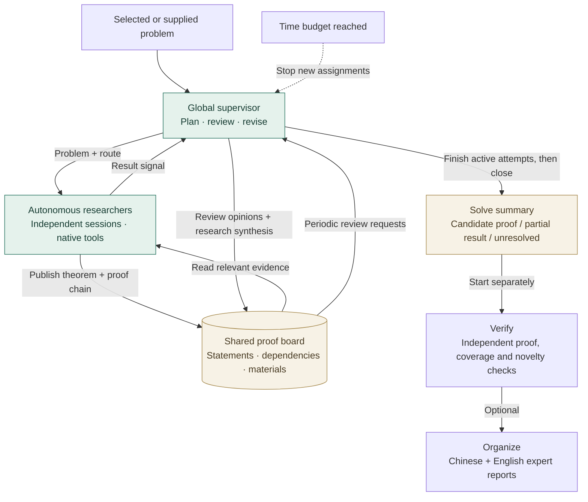

  <picture>
    <source media="(prefers-color-scheme: dark)" srcset="assets/mathlottery-logo-dark.svg">
    
  </picture>

<h2 align="center">Token is all you need.</h2>

  English | <a href="README.cn.md">简体中文</a>

  <a href="docs/usage.md">Usage</a> · <a href="docs/solve-teams.md">Supervised Solve</a> · <a href="showcase/README.md">Result showcase</a>

**Start with one researcher. Explore together when the budget allows.**

MathLottery is a local mathematics research project: let an agent find public problems, attempt solutions, and review its results. We want to see whether people without a mathematics background or large computing resources can use AI to produce something new in mathematics.

On the **`ai4math` branch**, Solve can coordinate a **global supervisor, autonomous research agents and a shared proof board**. The supervisor plans and reviews; researchers choose their own methods and share intermediate results. Find, independent Verify and Organize remain separate stages.

The idea came from a collection of mathematical research results published by OpenAI. OpenAI reported that each result used, on average, compute equivalent to roughly three hours of ChatGPT Pro thinking; the results were produced by internal models. That comparison makes us want to try, even if it does not mean the publicly available Pro mode already has the same capabilities. [Source: OpenAI's mathematics progress report](https://openai.com/index/sharing-ai-progress-in-mathematics/)

Our goal is simple: **give one agent a serious chance to explore and aim for a mathematical result worth checking.**

## What we want to do

### 1. Find: which problems are worth trying?

> I am not a mathematician. Even finding publicly stated, unsolved problems is difficult.

Start by asking the agent.

Let it search the web, read original papers and problem lists, and check the exact statements, existing progress, and whether a solution has already appeared. It should then explain why a problem is worth attempting, given its scope, the available tools, and the research budget.

You can also give it a problem you care about. Start with a small lemma or ask it to “solve Goldbach's conjecture.” You choose the research goal; the reasons for choosing a problem and the evidence for its unsolved status need traceable sources.

**Find → your choice → Solve:** compare the shortlist’s difficulty, verification and Lean feasibility, then choose a problem yourself. The solver receives the selected Find dossier and research notes; the recommendation never starts solving automatically.

### 2. Solve: supervised research with shared proofs

> Start with one researcher; let several explore different routes when resources permit.

Give it a problem, some time, and access to tools. Let it decide how to proceed: search the literature, break down the problem, derive lemmas, write programs, run experiments, look for counterexamples, and change direction when an approach fails.

The supervisor receives the original problem, proposes routes and sends each researcher the target and a direction. Researchers keep their own sessions and tools. They can publish intermediate theorems with assumptions, proof steps and dependencies to a shared board, or read relevant material on demand. The supervisor reviews new or challenged results and records its reasoning against the exact evidence version.

A researcher's return is a **signal**, not the end of Solve. A complete claim goes to the supervisor for review. If it is incomplete or rejected, the supervisor combines the board and previous attempts into a revised assignment while time remains. An accepted complete claim may close new assignments early; active researchers still return before the final summary; the optional **Use full Solve time budget** setting continues exploration and self-checking.

**The time budget stops new assignments, not ongoing research.** At three hours, for example, active attempts keep working until they return. The supervisor then reviews and saves the outcome without relaunching an unsuccessful researcher. Total duration can exceed three hours; explicit stop, provider failures and other configured limits still apply. Periodic board reviews wait for slot 1 to be free, because the supervisor shares that slot sequentially with the primary researcher.

Enable this mode for a **new standalone Solve** by setting **Solve parallelism** to 1–32 in the browser, or `solve.coordination: supervised` and an explicit `solve.parallel_agents` in configuration. Set a group cap and separate connections on the [Agents page](docs/agents.md) if needed. A null parallelism setting retains native delegation; old saved tasks retain their allocation protocol. The automatic `run` command retains its existing workflow. See the [Solve guide](docs/solve-teams.md) for setup, budgets and recovery.

The “lottery” refers to the uncertainty of research. An attempt might produce a complete proof, a partial result, a counterexample, or an approach that has been ruled out. Each outcome deserves an honest record.

**Supervisor acceptance is a Solve opinion, not independent verification or a novelty certificate.** The proof graph makes evidence inspectable; it does not establish theorem equivalence or guarantee that agents avoid all repeated work.

### 3. Verify: did we actually win?

> The agent wrote a proof, but I cannot follow it or tell whether it is correct.

Ask an agent to review it in a separate review session. It checks the problem, candidate proof, and references for missing assumptions, circular reasoning, calculation errors, and counterexamples. It also checks whether the supposedly new result already exists.

When it finds a problem, send specific feedback back to the original research session for revision. When it cannot reach a conclusion, keep that uncertainty in the record.

**Passing an agent review is only preliminary evidence.** Finite experiments and model approval cannot replace a mathematical proof. Calling a candidate a reliable new result requires stronger proof checking, with formal verification where suitable and review by mathematics experts.

### 4. Organize: make the result readable by an expert

> The proof, experiments and review are scattered across files. How can someone assess the whole argument?

After Verify, optionally ask **Organize** to assemble a readable account of the original problem, assumptions, proof strategy, detailed argument, supporting materials and review findings. It produces **Markdown and PDF reports**, with a source manifest and compact materials for inspection.

The report keeps missing steps, failed checks and uncertain novelty visible. Organizing a result does not raise its verification level; it prepares the record for human review.

## What the harness provides

We want to preserve as much of GPT's native agent capability as possible, leaving research methods and tool choices to the agent. MathLottery organizes each attempt into a research record that can be resumed, revisited, and checked:

- **Continuous research:** preserve the same research session and working files, resume after interruptions, and add guidance along the way.
- **Supervised collaboration:** assign and revise routes within user-set concurrency and group limits; share versioned theorems, proof chains and review opinions.
- **Native tools:** use official Codex search, shell, computation, and file tools, with a dedicated MathLottery login and tool configuration.
- **Research budgets:** account for researcher and supervisor usage; in supervised Solve, stop new work at the time limit and let current attempts return for review.
- **Results and review:** save candidate proof versions, references, review feedback, and research reports, distinguishing progress, conjectures, and verification evidence.
- **Evidence checks:** independently retrieve quoted sources, record missing evidence and original-problem coverage, and recheck attached Lean sources with bounded execution receipts. See the [evidence policy](docs/evidence.md).
- **Local browser workspace:** launch `mathlottery serve` to find problems, start solutions, review proofs, organize expert reports, and manage research history from your browser.

The code provides four independent workflows: **`find`, `solve`, `verify`, and `organize`**. The `run` workflow connects finding, solving and verification; organizing is an explicit, optional follow-up. Finding produces reusable problem statements, solving saves candidate proofs, verification produces a separate review, and organizing prepares matching Chinese and English expert reports, each in Markdown and PDF.

Choose an entry point independently of the agent engine: use the **browser** or **terminal** with **Codex agent** (`codex`, native tools and sessions, authenticated by ChatGPT login or OpenAI API key) or **API agent** (`chat`, an independent Responses harness with persistent context and hosted tools). Configure each Solve slot separately on the [Agents page](docs/agents.md). Compatible Responses providers can be configured separately; other protocols require an adapter. See [backend and model configuration](docs/configuration.md).

Contributions to the harness are welcome: improve problem selection, reduce repeated exploration, strengthen reviews, or try your own research strategy.

## Result showcase

[Explore the three publication candidates on `ai4math`](showcase/README.md): coefficientwise log-convexity of Sun's beta polynomials, the cubic Franel tail, and equidistribution of four mesh patterns on involutions. Each case includes complete bilingual expert reports, a submitted proof, historical review evidence and a list of remaining manuscript work; available Lean sources and certificates are included. These are candidates for expert review and manuscript development, not three certified new solutions. Large dependencies and runtime caches are excluded.

The beta case has a historical replay receipt for its main Lean declaration, with dependency pins and statement-equivalence certification still missing. Franel has a written candidate without a full formal receipt; mesh has partial Lean verification. Novelty remains “potentially new” or “unknown.” These historical results are not an evaluation of the new supervised workflow; each case's review records explain its evidence limits.

## Take your first shot

Start with the [browser quickstart](docs/usage.md#local-browser-workspace): install MathLottery, run `mathlottery serve`, and open the printed address. Sign in through the **MathLottery account** panel for Codex, choose a model, then **Find → choose a problem → Solve → Verify**. Follow with [**Organize**](docs/usage.md#organize) when you want expert reading reports in Chinese and English. This workspace's login is separate from your ordinary Codex CLI / IDE login.

In the terminal, use [`find`, `solve`, `verify`, `organize`, or `run`](docs/usage.md#cli) with the same workspace and configuration. `run` automatically connects the research stages; separate commands let you choose the problem between Find and Solve and request a report after Verify.

- [Installation and usage](docs/usage.md): browser quickstart, terminal workflows, and stop/resume.
- [Backend and model configuration](docs/configuration.md): Codex login, API credentials, providers, models, and budgets.
- [Supervised Solve](docs/solve-teams.md): supervisor, autonomous researchers, proof board, time budget and recovery.
- [Resource requirements](docs/resources.md): RAM, disk and CPU planning, measured Lean usage, caches, and WSL settings.
- [Architecture and recovery](docs/architecture.md): persistent sessions, saved state, and separate reviews.
- [Validation methods and scope](docs/local-validation.md): how to check the system and what those checks establish.
- [Legacy structured protocol](docs/protocol.md): compatibility with old checkpoints and offline demos.

You now know how to enter the lottery for an “AI mathematics result.”
