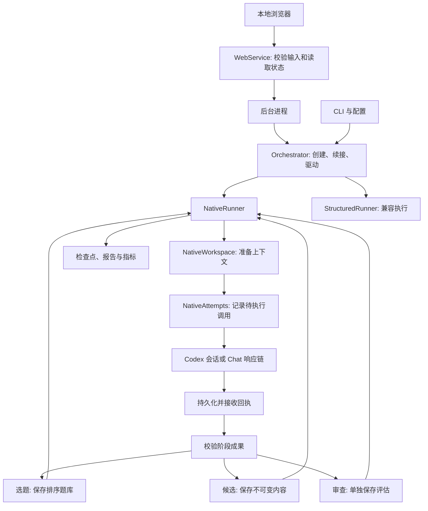

# 架构与恢复

[English](architecture.md) | 简体中文

[项目介绍](../README.cn.md) · [安装与使用](usage.cn.md) · [结果样本](../showcase/README.cn.md)

MathLottery 将 **agent 做什么**与 **如何调用 agent** 分开。找题、求解和验真是独立功能，Chat API 和 Codex 都能执行任意一项。

## 研究功能

| 功能 | 输入 | 输出与结束条件 |
| --- | --- | --- |
| find | 选题条件、优先来源、候选数量 | 带来源和状态证据的可复用题目排序；求解前结束 |
| solve | 已登记题目或直接研究请求 | 研究进展及不可变候选；最终候选结束求解，不自行认可证明 |
| verify | 题目及证明或候选 | 独立的真假、证明与新颖性判断；任何审查结论都结束本次验真 |
| pipeline | 可选题目或直接请求 | 必要时找题，随后求解、独立审查，并将意见交回同一研究者 |

CLI 命令 find、solve、verify 为运行设置明确的 Workflow，run 组成完整流程。Workflow 与 Phase 分开：前者是用户要求的功能，后者是当前阶段。续接任务保留原有功能。

## 组件

| 模块 | 职责 |
| --- | --- |
| web/server.py、web/static/ | 本地 HTTP 边界、打包的浏览器界面与轮询 |
| web/service.py | 校验浏览器输入，读取和展示共享研究状态 |
| web/jobs.py、web/worker.py | 独立后台执行、进程所有权锁与停止信号传递 |
| web/startup.py、web/network.py | 工作区定位、端口复用与递增、Windows 保留端口及显式 WSL 访问策略 |
| web/account.py | 通过私有 stdio 调用官方 Codex 账号 RPC，提供脱敏状态、设备码登录与显式账号切换 |
| codex_identity.py | 工作区独立的 Codex 目录、子进程环境和文件凭据存储 |
| workflows.py | 各功能的指令及排序后的找题结果 |
| agent_backend.py | 通用研究调用接口与后端选择 |
| chat_backend.py | 自动调用 Responses API、托管工具、上下文续接、轮询与取消 |
| native_backend.py | 官方 Codex CLI、精确续接会话、原生工具与事件日志 |
| codex_metadata.py | 白名单运行元数据与会话累计 token 的核对 |
| native.py | 原生研究循环及找题、求解、审查之间的转换 |
| native_attempts.py | 调用日志、持久化回执、会话 ID、记账与恢复 |
| native_workspace.py | 研究/审查工作区、提示准备及完整回答导入 |
| milestones.py | 与后端无关的阶段成果解析和验证 |
| candidates.py | 不可变候选文件、完整性检查和独立审查产物 |
| native_prompts.py | 研究目标与阶段成果登记，不规定逐动作协议 |
| orchestrator.py | 运行生命周期、执行分派、暂停续接与停止 |
| structured.py | 旧版 JSON/工具循环、已接收响应重放与手动提交 |
| metrics.py | 各阶段返回次数、交接失败、耗时及审查结果 |
| storage.py、budget.py、reporting.py | 检查点、限制、各功能结果及证据 |
| models.py、auditor.py | 领域类型、不可变候选与保守的验证等级 |
| backends.py、prompts.py、tools.py | 旧版 structured 执行与手动交接 |
| sources.py | 来源适配器与开放状态证据检查 |

## 代码流

1. CLI 解析配置和输入。`Orchestrator.create` 记录功能与初始阶段；`drive` 锁定运行并选择原生或兼容执行器。
2. `NativeWorkspace.prepare` 在审查前检查候选，写入任务输入并准备提示。研究保持原会话，每个候选使用独立审查上下文。导入的回答保留全部可见内容。
3. `NativeAttempts.invoke` 在调用后端前提交待执行记录，收到会话 ID 就立即保存。结果回执持久化后，`queue` 才对终态响应记账。
4. `NativeRunner.apply` 消费回执、记录工具实际观察的来源，并将通过校验的阶段成果交给选题、候选存储或审查处理。未通过审查时返回原研究会话；独立功能保留各自的结束规则。
5. 提交新检查点后再生成报告。恢复时先处理已有回执，再考虑调用模型。`StructuredRunner` 保留旧版响应和工具结果重放路径，不将旧协议施加给原生 agent。

`Store` 是共享存储，不决定研究策略。`CandidateStore` 负责候选完整性与审查产物，`NativeAttempts` 负责后端恢复；它们都不替研究者选择数学方法。

自动调用缺少阶段成果时，会记录可恢复的交接错误，在下一轮提示中要求登记已保存的结果，不再静默当成普通进展。Codex 首选写入工作区 JSON 文件；若没有写入，也接受回答中一条明确的 `mathlottery` 围栏代码块。两条路径都校验当前任务 ID 和负载。已有文件无效时，不会用回答代码块绕过错误。手动模式仍允许不附阶段成果的普通回答。

## 本地浏览器执行

`mathlottery serve` 启动本地 HTTP 服务，提供打包的 HTML、CSS 和 JavaScript。启动时定位 editable 源码项目，尊重显式选择的工作区，通过有限的实例探测复用匹配的服务，遇到不兼容的监听程序时尝试下一端口。在 WSL 中，还会在查询可用时跳过 Windows 保留的 TCP 端口范围。先绑定端口再初始化存储，并打印实际工作区和地址。默认仍监听 `127.0.0.1`，Windows 通过 WSL localhost 转发访问。只有显式 `--wsl-direct` 才启用 NAT 模式的 WSL 网卡入口与 Windows 网关客户端白名单。`--loopback-only` 保留默认行为，不修改 WSL、代理、端口转发或防火墙设置。

浏览器通过 JSON 接口创建、停止、续接和查看任务。服务检查客户端地址、Host、Origin 和写操作令牌，限制请求体大小，只提供明确列出的资源和接口，不提供通用文件浏览器。不可信的题目、证明和 agent 输出通过 DOM 文本节点显示。

`web/account.py` 通过有界、私有的 stdio RPC 连接官方 `codex app-server`。独立账号接口读取状态、发起设备码授权、取消待完成的登录，以及切换或退出账号。它们只调用账号方法：检查登录不会创建研究线程或启动模型回合。状态读取和普通登录复用已有的 MathLottery 账号，不自动切换。显式切换和退出请求除了满足普通浏览器写入检查，还必须携带 `confirm_account_change: true`；界面说明操作作用于当前 MathLottery 工作区。

每个 MathLottery Codex 子进程都使用独立的 `CODEX_HOME`，固定为 `<workspace>/.mathlottery/codex-home`，并显式覆盖 `cli_auth_credentials_store="file"`。账号 RPC、原生研究、旧版结构化调用、会话元数据读取与后台进程使用同一工作区身份。此目录由 Git 忽略，在 POSIX 系统上以仅当前用户可访问的权限创建。不修改父进程环境，不复制个人 Codex 凭据、配置和会话，也不回退到个人目录。平时使用的 Codex CLI / IDE 与 ChatGPT 网页保留各自的登录状态。依据见官方[环境变量](https://learn.chatgpt.com/docs/config-file/environment-variables)、[认证说明](https://learn.chatgpt.com/docs/auth)与 [app-server 文档](https://learn.chatgpt.com/docs/app-server)。

切换先调用官方 `account/logout`，再启动新的设备码授权；取消或未完成新授权后，MathLottery 独立目录保持退出状态。MathLottery 不备份凭据，也不会静默恢复旧账号。退出只清除当前工作区的登录，不修改个人 Codex 存储或浏览器 Cookie。可以在多个位置登录同一 ChatGPT 账号，但独立的登录存储不会提供独立的订阅额度。

服务检查后台进程和 orchestrator 的所有权锁，当前工作区有 Codex 任务运行时，阻止切换和退出。浏览器创建/续接任务与账号变更共用修改锁，避免浏览器提交的任务在检查结束和修改账号之间启动。独立的本地 IDE 会话使用另一份存储，不属于当前工作区任务检查范围。

凭据由官方 Codex 保存在独立且被 Git 忽略的目录。账号响应只公开账号类型、脱敏邮箱与订阅类型；等待登录时另提供官方验证网址和一次性验证码。MathLottery 将这些响应状态保留在内存中，校验验证网址，不向前端发送密码或令牌。账号加载独立于研究数据初始化，仅在授权待完成时轮询。此接入用于 Codex 后端；当前 Chat 后端继续从环境变量读取 API Key。

`WebService` 用 Pydantic 校验输入，通过 `Orchestrator.create` 保存配置快照，在导入候选进行独立审查前调用 `CandidateStore.check`。`web.worker` 进程执行 `drive` 或 `resume`，不引入第二套研究循环。SQLite 仍为权威状态，CLI 任务也会显示在同一界面中。

`review_evidence.py` 在持有空闲源任务所有权锁时，捕获明确选定的形式证明源码。浏览器请求绑定页面显示的候选 ID 和 SHA256。新审查的检查点保存有大小限制的源码内容、来源及哈希，与不可变候选分开存储；页面轮询只返回清单。原生 Codex 通过目录描述符投影文件，拒绝跟随软链接，续接时恢复检查点中的字节内容。原生 Chat 在更小的大小限制下直接收到提示内的源码文本。两种附件方式都不包含求解历史和旧审查结论。仅附加文件不会执行代码或提高证明等级；审查者可以请求下文介绍的独立形式检查。

后台进程继承覆盖启动和执行阶段的操作系统锁，界面服务重启后仍能识别正在运行的任务，防止浏览器重复续接，同时遵守 CLI 使用的核心运行锁。启动和续接过程中会传递停止标记，避免排队中的续接丢弃浏览器停止请求。进程状态与日志位于被忽略的任务目录。关闭界面后后台继续运行；显式停止仍走原有检查点恢复路径。退出的进程不会自动重新启动。

## Agent 调用后端

Codex 使用 codex exec 启动，通过 codex exec resume 在 MathLottery 独立目录中精确续接同一会话。它使用该目录中的模型和工具默认配置，并显式设置认证、沙箱、网络，以及可选的子 agent 与记忆开关。研究者自主决定方法和工具使用，原生研究不受逐动作输出结构或旧工具注册表约束。

Chat 使用配置的模型与托管工具创建 Responses API 后台请求。默认工具为 web_search 和 Code Interpreter；普通 Markdown 回答末尾可附一条机器可读的阶段成果记录。请求使用 previous_response_id 保留研究上下文，审查回答形成独立的上下文链，不涉及浏览器、提取 Cookie 或人工复制。

Chat API 凭据从环境变量读取，绝不读取 Codex 登录存储或请求文件中的凭据。API 错误不会触发后端或计费方式切换。Chat 模型必须通过配置、命令行参数或 OPENAI_MODEL 明确指定。API 原生工具在服务端运行，尚未实现需要客户端执行的自定义函数工具。

Python 框架在本地保存回答与响应元数据。托管容器和远端响应历史受服务商保留期限限制，本地检查点不能重建过期的远端上下文。Codex 的精确续接同样需要原始会话存储。保存在个人 Codex 目录中的旧原生会话不会迁移；已有 MathLottery 检查点与结果仍可读取，但缺少原始会话时可能需要新建任务。

手动交接是明确命名的兼容后端 manual。work 是 codex 的别名，--mode 是 --backend 的别名。迁移前保存的 chat 任务按 manual 加载，升级不会悄然转成 API 计费。

## 找题与证据

选题阶段成果包含推荐的 Problem 和有序候选列表。每题记录表述、来源、状态评估、难度、验证可行性和选择理由。找题将排序与原始 agent 判断保存到 literature/selection.json，并将可复用题目写入本地题库。

`literature.py` 在限制范围内独立下载引用来源，保存持久化回执；`evidence_policy.py` 核对原文摘录、来源角色、实际搜索记录和未解决缺口，不再按域名数量判断。证据不足时保留 UNKNOWN 并说明原因，已核对的未解状态与等价解答冲突时记为 DISPUTED。原始提案仍保存在选题产物中。即使有证据支持，状态也只是 agent 判断，不是认证。详见[证据规则](evidence.cn.md)。

## 审查

每个候选都获得新的审查上下文和独立可写工作区。初始审查提示只含题目、候选内容和引用，排除求解历史和既有审查。Codex 审查者的记忆功能被禁用。指令禁止读取求解者文件，但 workspace-write 并非完整的文件读取边界。

独立 verify 任务在任何结论后结束，包括 INCONCLUSIVE。完整流程则将未通过的审查交回原研究者。通过审查的部分结果也会继续研究，除非已被指定为最终交付。独立 solve 保存候选，不启动审查。

导入候选进行新审查时保留 claim、assumptions 和 references。历史校验和仍覆盖命题与证明；完整性检查还会将假设、引用、身份等全部不可变字段与权威检查点逐项比较。审查提示和 `candidate.json` 都排除既有结论与验证等级。审查结果单独保存，原候选文件保持不变。模型认可和有限实验不会转化为 FORMALLY_VERIFIED 或 EXPERT_REVIEWED。

候选范围与剩余证明义务同样不可变。`auditor.py` 要求肯定审查有明确检查项，原题覆盖与正确性、新颖性分别记录；两种运行器都依据经过规则处理的结论决定是否返回求解。`native_formal.py` 对明确附加的冻结源码进行 bubblewrap 隔离编译、提交模块的内核重放及可信定理/公理检查，限制时间和资源，不执行提交的 Lake 配置，也不接受自称编译成功。回执将源码绑定到候选与原题，但不认证命题等价性。旧记录缺失的新增字段默认为未评估，不追溯改写结论。

## 持久化与恢复

SQLite 是权威状态来源。运行保存其功能、后端、策略、设置、题目、候选，以及分别存储的 Codex 会话 ID 和 Chat 响应 ID。报告与其他产物是这些状态的投影。

当前调用尝试在执行前提交保存。Codex 一旦报告会话 ID 就立即记录；Chat 一旦收到响应对象就保存，包括其 ID。在用量记账和应用阶段成果之前，先持久化结果回执。

若运行器在 API 响应保存后崩溃，恢复时会取回该响应或重放本地终态结果，不创建第二个响应。待完成的后台调用在最终结果到达时记账。若创建失败且没有已知响应 ID，则保留未解决状态，因为自动重试可能造成重复执行。

Ctrl+C、超时和 stop 会请求取消 Chat 服务端调用。取消失败时保留待处理尝试供恢复；连接失败后发出的 stop 也会尝试取消脱离本地连接的远端工作。中断 Codex 时停止其子进程组，恢复时先识别孤儿进程再发送信号，不选择无关进程或会话。

Codex 已完成的可见消息也会保存到 `progress.md`。中断调用没有最终回答时，这些消息会成为保存的部分回答；调用仍标记为中断，不会接收该轮的候选或审查。续接或切换后端时可以使用这些可见工作。中断进程遗留的成果文件本身，不代表后端已成功完成。

存在未完成调用时拒绝切换后端。其他情况下，各后端保留自己的续接 ID，并导入另一后端已记录的研究回答。恢复期间收到的补充方向会保留给下一轮。

## 预算与验证

时间预算统计活跃研究时间，排除暂停与人工等待时间。轮数统计研究交接，不统计原生工具调用。Token 上限使用后端实际报告，在调用之间检查；单次调用可能超过阈值。

Codex 可能在一轮结束时返回会话累计用量。续接调用会将返回值与同一会话的调用前后计数核对，只计本次增量；能够确认的逐轮报告也受支持。计数缺失或不一致时保留未知，不将累计数当作单轮用量相加。历史检查点保留原始数值，报告会标记尚未核对的旧记录，不静默修改历史。

每次报告根据保存的状态生成 `metrics.json`：各阶段返回次数与完成轮数、缺失/无效阶段成果、实测调用耗时、候选数量及最新审查结论。旧记录缺少阶段或耗时时保持未知。待完成调用及恢复可能产生多次返回，因此返回次数不等于计费调用次数。这些指标用于发现流程故障，不衡量证明正确性或新颖性。

程序不计量 API 金额、订阅余额或第三方服务费用。旧配置 max_external_cost_usd 为零时阻止 Chat API 调用；null 将消费控制交给服务商账户。不会通过后端回退绕过该设置。

合约测试使用模拟 Responses 调用和脚本化 Codex 可执行文件，验证编排与恢复，不衡量数学能力。真实模型评测需要配置凭据并另行选择研究预算。

设置与命令见[安装与使用](usage.cn.md)，可复用检查步骤见[验证指南](local-validation.cn.md)，研究产出及证据边界见[结果样本](../showcase/README.cn.md)。

## 用户选题与找题上下文

独立 Find 以候选列表结束，推荐的 `problem` 不代表用户选定。前端把用户选择绑定到 Find 任务及题目校验值。`Orchestrator.solve_discovered` 锁定来源，验证题目归属和版本，再创建带冻结 `DiscoveryContext` 的新求解任务。`discovery.py` 在可配置上限内保存支持的研究笔记、完整可见回答与来源，`artifact_io.py` 通过不跟随符号链接的文件访问进行读取和投影。SQLite 保存清单，校验值检测快照后续变更。找题和求解不共享可变会话；验真工作区不接收该资料包。显式 CLI `run` 流程仍保留自动选题。

`native_multi_agent` 和 `native_memories` 支持空值以继承独立 Codex 默认配置；验真始终禁用长期记忆。`search_trace.py` 从完成的原生网页搜索和可识别 MCP 搜索输入记录查询，不从生成的回答推断已执行检索。这些记录不认证来源结论，引用摘录仍独立抓取核对；任意 Shell 脚本尚不作为检索回执解析。
