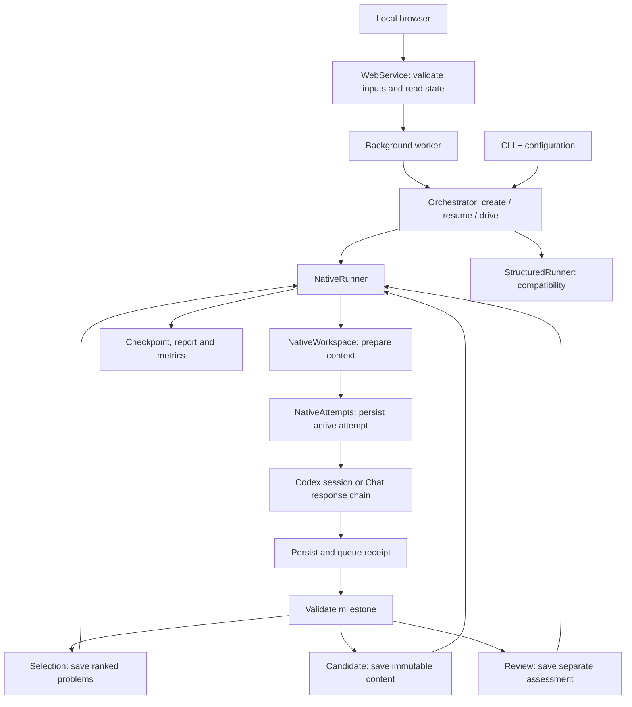

# Architecture and recovery

English | [简体中文](architecture.cn.md)

[Project overview](../README.md) · [Usage](usage.md) · [Result showcase](../showcase/README.md)

MathLottery separates **what the agent does** from **how the agent is invoked**. Finding, solving and verifying are independent workflows; both Chat API and Codex can execute any of them.

## Research functions

| Workflow | Input | Output and termination |
| --- | --- | --- |
| find | Selection criteria, preferred sources, shortlist target | Ranked reusable problems with provenance and status evidence; stops before solving |
| solve | A registered problem or direct research request | Research progress and immutable candidates; a final candidate ends solving without self-approval |
| verify | A problem and a proof or candidate | Independent truth, proof and novelty assessments; every review verdict ends the audit |
| pipeline | Optional problem or direct request | Find when needed, solve, independently review, return feedback to the same researcher |

The CLI commands find, solve and verify set an explicit Workflow on the run. run composes the pipeline. Workflow and Phase are separate: the former is the user's requested function, the latter is the current stage. A resumed task retains its workflow.

## Components

| Module | Responsibility |
| --- | --- |
| web/server.py, web/static/ | Local HTTP boundary, packaged browser interface and polling |
| web/service.py | Validated browser inputs and projections over shared research state |
| web/jobs.py, web/worker.py | Detached execution, worker ownership locks and stop propagation |
| web/startup.py, web/network.py | Workspace discovery, port reuse/fallback, Windows reservations and explicit WSL access policy |
| web/account.py | Official Codex account RPC over private stdio, masked status, device-code sign-in and explicit account changes |
| codex_identity.py | Workspace-specific Codex home, child environment and file credential storage |
| workflows.py | Function-specific instructions and ranked discovery results |
| agent_backend.py | Common research transport interface and backend selection |
| chat_backend.py | Automatic Responses API calls, hosted tools, context continuation, polling and cancellation |
| native_backend.py | Official Codex CLI, exact session continuation, native tools and event logs |
| codex_metadata.py | Whitelisted runtime metadata and reconciliation of cumulative token counters |
| native.py | Native research loop and find/solve/review transitions |
| native_attempts.py | Invocation journal, durable receipts, session IDs, accounting and recovery |
| native_workspace.py | Research/review workspaces, prompt preparation and complete imported answers |
| milestones.py | Transport-independent milestone parsing and validation |
| candidates.py | Immutable candidate artifacts, integrity checks and separate review projections |
| native_prompts.py | Research objectives and milestone registration, without a per-action protocol |
| orchestrator.py | Run lifecycle, execution dispatch, pause/resume and stop |
| structured.py | Legacy JSON/tool loop, accepted-response replay and manual submissions |
| metrics.py | Measured stage returns, handoff failures, timings and review outcomes |
| storage.py, budget.py, reporting.py | Checkpoints, limits, per-workflow results and evidence |
| models.py, auditor.py | Domain types, immutable candidates and conservative verification levels |
| backends.py, prompts.py, tools.py | Legacy structured execution and manual handoff |
| sources.py | Source adapters and evidence checks for open status |

## Code flow

1. The CLI resolves configuration and inputs. `Orchestrator.create` records the workflow and initial phase; `drive` locks the run and selects the native or compatibility runner.
2. `NativeWorkspace.prepare` checks the candidate before review, writes task inputs, and prepares the prompt. Research keeps its original session; each candidate starts a separate reviewer context. Imported answers retain their full visible content.
3. `NativeAttempts.invoke` commits the active attempt before calling a transport. Session IDs are saved as soon as they arrive. It persists the result receipt before `queue` accounts for a terminal response.
4. `NativeRunner.apply` consumes the receipt, records tool-observed sources, and dispatches a validated milestone to selection, candidate storage or review. An unsuccessful review returns to the existing research session; standalone workflows retain their own stop rules.
5. The new checkpoint is committed before generating reports. Recovery consumes saved receipts before considering another model call. `StructuredRunner` retains the old accepted-response/tool-result replay path without imposing it on native agents.

`Store` is shared infrastructure; it does not decide research strategy. `CandidateStore` owns candidate integrity and review artifacts, while `NativeAttempts` owns transport recovery. Neither module selects mathematical methods for the researcher.

For automatic turns, a missing milestone is a recoverable handoff error: the next prompt requests registration of the saved result, rather than silently treating an unregistered answer as ordinary progress. Codex primarily submits a workspace JSON file; if it omits that file, one explicit fenced `mathlottery` block in the answer is also accepted. Both routes validate current task IDs and payloads. An invalid existing file is never bypassed by choosing an answer block. Manual answers may still omit milestones.

## Local browser execution

`mathlottery serve` starts a local HTTP server with bundled HTML, CSS and JavaScript. Startup locates an editable checkout, honors explicit workspace selection, reuses a matching service through a bounded instance probe, and tries another port for incompatible listeners. On WSL, it also skips Windows-reserved TCP ranges when they can be queried. It binds before initializing storage and prints the actual workspace and address. The default listener remains `127.0.0.1`, with Windows access through WSL localhost forwarding. Only explicit `--wsl-direct` enables the NAT-mode WSL interface and its Windows gateway peer allowlist. `--loopback-only` preserves the default behavior. No WSL, proxy, port-forwarding or firewall settings are changed.

The browser uses JSON endpoints for task creation, stop, resume and status. The server validates the peer, host, origin and write token, limits request bodies, and serves only an explicit asset/API allowlist. It does not expose a general filesystem browser. Untrusted problem, proof and agent text is inserted using DOM text nodes.

`web/account.py` opens a bounded, private stdio RPC connection to official `codex app-server`. Separate account endpoints read status, start device-code authorization, cancel a pending login, switch accounts and sign out. They use account methods only: checking a login never creates a research thread or starts a model turn. Status reads and ordinary sign-in reuse an authenticated MathLottery account without automatic switching. Explicit switch and sign-out requests require `confirm_account_change: true`, in addition to the usual browser write checks; the UI explains the change applies to the current MathLottery workspace.

Every MathLottery Codex child process receives a dedicated `CODEX_HOME` at `<workspace>/.mathlottery/codex-home` and an explicit `cli_auth_credentials_store="file"` override. Account RPC, native research, structured compatibility calls, metadata reads and background workers use this same workspace identity. The home is Git-ignored and created with owner-only permissions on POSIX. The parent's environment is not mutated; personal Codex credentials, configuration and sessions are never copied or selected as a fallback. Ordinary Codex CLI / IDE clients and ChatGPT website sessions retain their own login state. See the official [environment variables](https://learn.chatgpt.com/docs/config-file/environment-variables), [authentication](https://learn.chatgpt.com/docs/auth) and [app-server](https://learn.chatgpt.com/docs/app-server) documentation.

Switching calls official `account/logout` before starting new device-code authorization. Cancelling or failing that authorization leaves the MathLottery home signed out. MathLottery neither backs up credentials nor silently restores the old account. Sign-out clears only this workspace's login without changing personal Codex storage or browser cookies. A user may sign in with the same ChatGPT account in multiple places; separate login storage does not create separate subscription quotas.

The service blocks switch and sign-out while a Codex task is running in the current workspace, checking worker and orchestrator ownership locks. Browser task creation/resume and account changes share a mutation lock so a browser task cannot start between the check and the account change. Independent local IDE sessions use different storage and are outside this workspace's task checks.

Official Codex owns credentials in the dedicated ignored home. Account responses expose only the account type, masked email and plan, plus an official verification URL and one-time code while login is pending. MathLottery keeps this response state in memory, validates the verification URL, and sends no passwords or tokens to the frontend. Account loading is separate from research bootstrap, with polling only while authorization is pending. This connects the Codex backend; the current Chat backend continues to read its API key from the environment.

`WebService` validates inputs with Pydantic, snapshots configuration through `Orchestrator.create`, and uses `CandidateStore.check` before importing a candidate for independent review. A `web.worker` process executes `drive` or `resume`; it does not add a second research loop. SQLite remains authoritative, and CLI runs are visible in the same UI.

`review_evidence.py` captures explicitly selected formal sources while holding the idle source run's ownership lock. The browser binds its request to the displayed candidate ID and SHA256. The new review checkpoint stores the bounded source contents, provenance and hashes separately from the immutable candidate; polling exposes only the manifest. Native Codex projects this evidence through directory descriptors without following symbolic links, and resumes restore the checkpointed bytes. Native Chat receives the same source contents inline under a smaller size limit. Neither path includes solver history or prior verdicts, runs attached code automatically, or promotes the proof level.

Each worker inherits an OS ownership lock held across startup and execution. It survives server restarts, rejects duplicate browser resumes, and also respects the core run lock used by the CLI. Stop markers are propagated during startup/resume so a queued resume cannot discard a browser stop request. Worker status and logs live in the ignored run directory. Closing the UI leaves workers running; explicit stop preserves the normal recovery path. A dead worker is never automatically relaunched.

## Agent transports

Codex starts with codex exec and continues the exact session using codex exec resume in the dedicated MathLottery home. It uses that home's model/tool defaults, with explicit authentication, sandbox, network and single-agent settings. The researcher controls methods and tool use. No per-action output schema or legacy tool registry is imposed on native research.

Chat creates background Responses API requests with a configured model and hosted tools. The default tools are web_search and Code Interpreter; ordinary Markdown answers may contain a single machine-readable milestone at the end. Requests use previous_response_id to retain the research context. Reviewer responses form a different chain. No browser, cookie extraction or manual copying is involved.

Chat API credentials are read from an environment variable, never from Codex login storage or request files. API errors do not trigger a switch of backend or billing. Chat model selection must be explicit through configuration, a CLI option or OPENAI_MODEL. API-native tool execution is server-hosted; client-executed custom function tools are not implemented.

The Python harness saves answers and response metadata locally. Hosted containers and remote response history have provider retention limits; local checkpoints do not recreate expired remote contexts. Codex similarly needs its original session storage for exact continuation. Old native sessions stored in a personal Codex home are not migrated; existing MathLottery checkpoints and results remain readable, but a missing original session can require a new run.

Manual handoff is an explicitly named compatibility backend. work aliases codex, and --mode aliases --backend. Saved pre-migration chat runs are loaded as manual, so upgrading cannot silently convert them to API billing.

## Discovery and evidence

A selection milestone contains the recommended Problem and an ordered shortlist. Each problem records its statement, source, status assessment, difficulty, verification feasibility and selection reason. Discovery saves the ranking and raw agent assessment in literature/selection.json and saves reusable problems in the local problem library.

Open-status evidence is checked against source URLs reported by backend tools. Unsupported status assertions remain UNKNOWN in the problem library; the original proposal is retained in the selection artifact. The existing conservative policy requires recent evidence from at least two domains, including the problem's primary source. Even supported status is an agent assessment, not certification.

## Review

Every candidate gets a fresh reviewer context and a separate writable workspace. Only the problem, candidate content and references enter the initial review prompt; solver history and prior reviews are excluded. Codex reviewer memories are disabled. Instructions prohibit reading solver files, but workspace-write is not a complete read boundary.

Independent verify tasks end after any verdict, including INCONCLUSIVE. The pipeline instead returns unsuccessful reviews to the original researcher. A passing partial result also continues unless designated as the final deliverable. Independent solve saves candidates without launching review.

Candidates retain their claim, assumptions and references when imported for a new audit. The historical checksum still covers claim and proof; integrity checks additionally compare all immutable candidate fields against the authoritative checkpoint, including assumptions, references and identity. Both the review prompt and its `candidate.json` exclude prior verdicts and verification levels. Reviews are written separately, leaving the original candidate file unchanged. Model approval and finite experiments never become FORMALLY_VERIFIED or EXPERT_REVIEWED.

## Persistence and recovery

SQLite is authoritative. Runs snapshot their workflow, backend, strategy, settings, problems, candidates and separate Codex session / Chat response identifiers. Reports and other artifacts are projections.

The active attempt is committed before invocation. Codex session identifiers are recorded immediately when reported. Chat saves the response object, including its identifier, as soon as it is received. A durable result receipt is queued before accounting and milestone application.

If a runner crashes after an API response was saved, recovery retrieves that response or replays its terminal local result; it does not create a second response. Pending background calls are accounted when their terminal result arrives. A failed creation with no known response ID is kept unresolved, since automatically retrying could duplicate work.

Ctrl+C, timeout and stop request server-side cancellation for Chat. Cancellation failures preserve the pending attempt for recovery. A stop issued after a connection failure also attempts to cancel detached remote work. Codex interruption stops its subprocess group; recovery identifies orphan processes before signalling them. No unrelated process or session is selected.

Codex's completed visible messages are also saved to `progress.md`. If an interrupted call has no final answer, those messages become its saved partial answer, while the call remains interrupted and no candidate or review is accepted from that turn. Resuming or switching transports can use that visible work. A submission file left by an interrupted process is not, by itself, proof that the backend completed successfully.

Switching transports while an invocation is pending is rejected. Otherwise each transport retains its own continuation identifiers, and recorded research answers from the other transport are imported. An additional direction arriving during recovery is preserved for the following turn.

## Budgets and verification

Time budgets count active research time; paused and manual waiting time is excluded. Rounds count research handoffs, not native tool calls. Token limits use actual backend reports and are checked between calls; a single call may exceed a threshold.

Codex can report cumulative session usage at the end of a turn. For resumed calls, the transport compares that report with the same session's before/after counters and charges only the increment. Confirmed per-turn reports are also supported. Missing or inconsistent counters remain unknown, rather than being added as if they were per-turn measurements. Historical checkpoints keep their recorded totals; reports flag unreconciled old records instead of silently rewriting them.

Each report projects `metrics.json` from the saved state: returns and completed turns by phase, missing/invalid milestones, measured invocation time, candidates and latest review verdicts. Historical records without phase or timing stay unknown. Pending/recovered calls can have multiple returns, so returns are not a billable-call count. These measurements expose workflow failures; they do not measure proof correctness or novelty.

API dollar costs, subscription balance and third-party services are not metered. A legacy max_external_cost_usd value of zero blocks Chat API calls; null delegates spending control to the provider account. No backend fallback bypasses this setting.

Contract tests use a mock Responses transport and a scripted Codex executable. They verify orchestration and recovery, not mathematical ability. Real model evaluations require configured credentials and a separately chosen research budget.

For setup and commands, see [installation and usage](usage.md). The [validation guide](local-validation.md) covers reproducible checks; the [showcase](../showcase/README.md) presents research outputs and their evidence limits.
