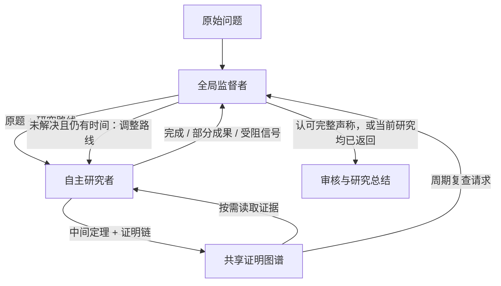

# 监督式 Solve

[English](solve-teams.md) · [使用说明](usage.cn.md) · [Agent 接入配置](agents.cn.md)

Solve 支持“全局监督者 + 自主研究者 + 共享证明留言板”的工作流。
在页面打开 **Solve → 预算与 agent 设置**，填写**求解并行数**（1–32），按需填写
**最大研究组数**。默认 `solve.coordination: supervised`，即使只有一个研究者，也有
独立的监督会话。并行数配置为 `null` 时，保留原来的原生自主委派流程。

终端运行可使用以下配置：

```yaml
solve:
  coordination: supervised
  parallel_agents: 4
  max_groups: 2
  board_review_interval_seconds: 300
  supervisor_timeout_seconds: 600
budget:
  max_wall_time_minutes: 180
  max_iterations: 100
```

随后执行 `mathlottery solve --problem <problem-id>`。并行数限制所有组的研究者总数，
人数和组数都不要求占满。组数上限需要明确的并行数，每个活动组至少有一个研究者。
此调度仅适用于 Codex 或 Responses API 的**独立原生 Solve**；Find、Verify、Organize、
组合命令 `run` 及 structured/manual 执行方式保留原协议。

需要不同账号或模型时，先在 `/agents` 配置，再勾选**使用已配置的 agent 槽位**。
各槽位在分组调整和恢复中保留自己的账号、接入和会话。监督者与主研究者**顺序复用
槽位 1**，不会因此在同一槽位额外并发。已有任务固定其槽位配置，更换身份或槽位数量
需要新建任务。

## 研究与审核循环



监督者规划具体路线和受人数、组数上限约束的研究组。研究者保留原生工具、持续会话、
本地笔记及自查能力，在有意义的检查点返回。返回是通知监督者的信号，不直接结束 Solve。
若只有部分成果或路线受阻，监督者综合留言板和其他尝试，发布整理记录，并在时间仍然
允许时下发新方向。

完整解答声称必须经过监督者对**指定候选 ID 和哈希版本**的审核，检查原题覆盖、证明
步骤、前提、边界情况及剩余义务。驳回或不完备的声称返回研究阶段；缺失或格式错误的
审核会暂停，不能绕过检查。认可的完整声称可以提前结束；若启用
`budget.solve_until_budget_exhausted`，则继续使用剩余时间研究、自查。
监督审核仍属于 Solve，**不能替代独立 Verify、Lean 检查、专家审核或新颖性判断**。

`board_review_interval_seconds` 定期触发对未审查或受到质疑的定理的复查请求。
请求会等待槽位 1 空闲；其他研究者可以同时继续工作，不会为了腾出槽位强行结束长时间
的主研究调用。提示词鼓励研究者在接近该间隔时选择自然检查点，但不强制截断。
这是调度间隔，不是保证每隔这些秒数就完成一次审核。

明确并行数后，关闭原生嵌套创建 agent，新增研究者由监督调度；搜索、命令执行、研究
记忆和原生上下文压缩仍可使用。程序检查总人数与活动组数上限。

## 证明留言板和依赖图

Codex 研究者按工作区的 `board-message.schema.json` 写入 `outbox/<唯一编号>.json`，
发布成果、问题、质疑、失败路线、意向或撤回。可复用的中间定理包含：

- `theorem.statement`：精确陈述；前提放在留言的 `assumptions`。
- `theorem.proof_steps`：唯一的步骤 ID、步骤结论、前向步骤 ID 和推导理由。
- `theorem.conclusion_step`、来源 `references`、`remaining_obligations`。
- `depends_on`：已经发布的前提定理留言编号；也可引用冻结的 UTF-8 证明文件。

程序拒绝证明步骤中的循环、前向未定义依赖，以及不存在的留言依赖。这保证结构合法，
不保证数学正确。`bulletin/index.json` 提供索引，`bulletin/graph.json` 中的边从前提指向
推导结果。研究者按需打开相关证明和材料，不必把所有证明塞进上下文。这是依赖图和
词语检索，并非数学等价规范化语言，也不保证完全避免重复证明。

留言和引用材料不可覆盖，修改须使用新编号。监督意见绑定内容哈希、已检查步骤和前提
审核版本。认可中间定理要求没有未完成义务、检查了全部证明步骤，且前提已审查。
撤回、未解决的质疑会使后续依赖结果需要复查。重新认可须明确回应质疑；前提的审核
版本发生变化，也需要重新检查后续认可。`supervisor_accepted`、`author_checked` 都是
可能有误的研究意见。

Responses agent 在一次研究中也可实时使用 `solve_board_search`、`solve_board_read`、
`solve_board_material`、`solve_board_publish`、`solve_board_status`，同时保留已配置的托管
工具。它可以内联发布证明链、按需读取已发布材料，而不获得任意本地文件访问权。
函数循环遵循[官方 Responses 函数调用协议](https://developers.openai.com/api/docs/guides/function-calling)。

留言 JSON 最大 100 KB，单份冻结材料最大 2 MB。大型数据和编译产物保留在研究工作区。
Codex 发布失败原因写入 `bulletin/publication-errors.json`；API 工具直接返回错误。

## 时间、恢复与结果

时间预算是**停止派发新研究的界线**。例如设置 3 小时，到达预算后：

1. 不再启动新的研究尝试。
2. 正在进行的尝试继续，直到研究者返回，包括尚未解决的情况。
3. 监督者审核返回的声称，整理部分成果、未解决结果或认可的完整解答声称；未解出的
   研究者不再被重新派发任务。

因此实际总时长可以超过 3 小时，收尾阶段没有隐含的总时间强制截断。显式用户停止、
单次调用超时配置、服务商错误和非时间限额仍然生效；监督调用有独立超时。Token 限额
在尝试之间检查，并行调用返回时可能已超过阈值。派发研究时预留最终监督调用的次数，
但显式硬限额仍可能阻止审核，此时保留证据并明确暂停。
`budget.finalize_minutes` 仍用于原生/旧版协议的收尾，不控制此监督式流程。

前端展示规划、研究、等待当前研究返回、审核整理等阶段，以及监督意见、证明链和研究
活动。每个任务保存：

- `solve/summary.md`：原题、综合结果、尝试记录、证据位置。
- `solve/supervision.json`：信号、具体候选审核、决策及结果。
- `workspace/bulletin/`：留言索引、依赖图、审核意见和冻结材料。
- `tasks/`：持久化调用回执和会话引用。

研究和监督用量都计入总量；API 函数续接会累计各响应的 token。恢复时只消费一次已完成
回执，续接已有会话、读取未完成的 API 响应；付费 POST 结果不确定时不自动重发。
认证或额度错误不会触发账号轮换。

旧任务自动保留 `coordination: allocation`，继续使用原来的按轮分配和到时处理规则。
续跑不会悄悄更换协议；需要新建 Solve 才会使用监督式流程。`allocation` 也可显式配置
作为兼容选项；并行数为 `null` 仍使用原生自主委派。

运行 `pytest -q tests/test_solve_campaign.py tests/test_solve_board_tools.py` 可检查调度、
恢复和工具循环。这些是受控测试，不是数学能力或付费模型效果实验。
