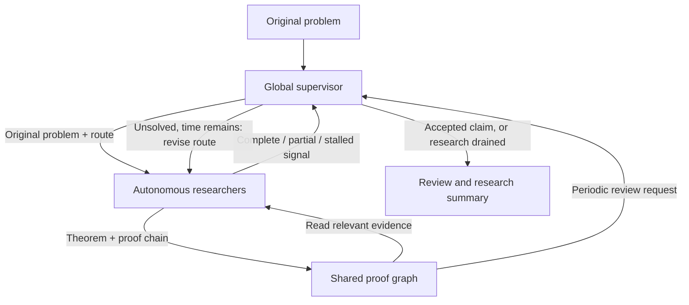

# Supervised Solve

[中文](solve-teams.cn.md) · [Usage](usage.md) · [Agent connections](agents.md)

Solve can run as a global supervisor, autonomous researchers and a shared proof board.
In the browser, open **Solve → Budget & agent settings** and enter **Solve parallelism**
(1–32), plus an optional **Maximum research groups**. With the default
`solve.coordination: supervised`, even one researcher has a separate supervisor session.
Leave parallelism `null` to retain the original native delegation workflow.

For CLI tasks, configure:

```yaml
solve:
  coordination: supervised
  parallel_agents: 4
  max_groups: 2
  board_review_interval_seconds: 300
  supervisor_timeout_seconds: 600
budget:
  max_wall_time_minutes: 180
  max_iterations: 100
```

Then run `mathlottery solve --problem <problem-id>`. The parallelism cap covers all
researchers across all groups; neither cap has to be filled. `max_groups` requires
explicit parallelism, and each active group needs at least one researcher.
These settings apply to standalone native Solve, using Codex or Responses API.
Find, Verify, Organize, the composed `run` workflow and structured/manual execution
keep their existing protocols.

For separate accounts/models, configure `/agents` and select **Use configured agent
slots**. Each slot retains its account, transport and conversation across regrouping
and recovery. The supervisor uses slot 1 **sequentially** with the primary researcher;
it never adds an overlapping invocation on that slot. Explicit slot rosters are frozen
in the run; changing identities or roster size requires a new task.

## Research and review loop



The supervisor proposes concrete routes and bounded groups. Researchers keep their
native tools, persistent conversations, local notes and self-checks. They return at
meaningful checkpoints. A return is a signal, not automatic completion of Solve.
A stalled or partial attempt prompts the supervisor to inspect available evidence,
record a synthesis on the board and assign another route while time remains.

A complete claim must receive a supervisor review tied to its candidate ID and hash.
The review covers the original statement, proof steps, hypotheses, boundary cases
and remaining obligations. Rejected or incomplete claims return to research. Missing
or malformed reviews pause execution; they never silently approve a proof. Approved
claims may end early unless `budget.solve_until_budget_exhausted` is enabled.
Supervisor opinions are part of Solve and **do not replace independent Verify**, Lean
checking, expert review or novelty assessment.

`board_review_interval_seconds` requests periodic inspection of unreviewed or
challenged theorems. A request waits for slot 1 to be free. Other researchers may keep
working during supervision; a long primary turn is not killed to make room. Research
prompts encourage natural checkpoints near this interval, without a forced turn timer.
This is a scheduling interval, not a guaranteed review-completion deadline.

Nested native agent spawning is disabled when an explicit cap is set. Researchers
request extra help through the supervisor; native search, shell, memory and conversation
compaction remain available. The host enforces researcher and active-group ceilings.

## Proof board and dependency graph

Codex researchers publish `outbox/<unique-id>.json` using the provided
`board-message.schema.json`. Messages can be results, questions, objections, failed
routes, intentions or retractions. A reusable theorem carries:

- `theorem.statement`: the exact mathematical statement; `assumptions` on the message.
- `theorem.proof_steps`: unique step IDs, conclusions, earlier premise IDs and justifications.
- `theorem.conclusion_step`, source `references` and `remaining_obligations`.
- `depends_on`: already-published theorem message keys; optional frozen UTF-8 proof files.

The controller rejects cyclic or forward proof-step dependencies and missing message
dependencies. This checks structure, not mathematical truth. `bulletin/index.json`
indexes messages; `bulletin/graph.json` points from prerequisite nodes to derived nodes.
Open the linked message/material files on demand instead of inserting every proof
into context. This is a dependency graph and lexical index, not a universal mathematical
equivalence engine or guaranteed duplicate-proof prevention.

Publications and cited material bytes are immutable. Corrections use new IDs. A
supervisor opinion binds to the content hash, checked proof steps and dependency-review
versions. To accept a theorem it must have no open obligations and all its steps and
prerequisites must be covered. Retractions and unresolved objections invalidate
dependent claims. Objections must be explicitly addressed before reacceptance; changes
to prerequisite reviews invalidate downstream acceptance until rechecked.
`supervisor_accepted` and `author_checked` remain fallible research opinions.

Responses agents have live `solve_board_search`, `solve_board_read`,
`solve_board_material`, `solve_board_publish` and `solve_board_status` functions,
alongside their configured hosted tools. They can publish inline proof chains and read
published materials during the same attempt, without general access to local files.
The function loop follows the [official Responses function-calling protocol](https://developers.openai.com/api/docs/guides/function-calling).

Message JSON is limited to 100 KB and each frozen artifact to 2 MB. Keep large datasets
and build products outside the shared board. Codex publication errors appear in
`bulletin/publication-errors.json`; API tools return explicit publication errors.

## Time, recovery and results

The wall-time budget is an **admission deadline**. For a 3-hour task, after 3 hours:

1. No new research attempt is launched.
2. Already-running attempts continue until they return, even if they are still unsolved.
3. The supervisor reviews returned claims and organizes the final partial/unsolved or
   accepted-claim summary. No unsuccessful researcher is relaunched.

Total duration can therefore exceed 3 hours; there is no automatic tail-time cutoff.
Explicit user stop, per-turn timeout settings, provider failures and non-time limits
still apply. Supervision has its own timeout. Token thresholds are checked between
attempts, so parallel in-flight work can overshoot them. Calls reserve space for a final
supervisor review; an explicit hard limit can still prevent closing, which is reported
as a pause with saved evidence. `budget.finalize_minutes` belongs to the original
native/legacy closing protocol, not this supervised deadline behavior.

The browser shows planning, research, draining and closing, along with supervisor
opinions, derivations and researcher activity. Each run keeps:

- `solve/summary.md`: original target, synthesis, attempts and evidence locations.
- `solve/supervision.json`: signals, exact candidate reviews, decisions and outcome.
- `workspace/bulletin/`: message index, graph, reviews and frozen materials.
- `tasks/`: durable invocation receipts and session references.

All research and supervision usage counts toward totals. API function continuations
sum usage across their responses. Recovery consumes completed receipts once, resumes
saved conversations and retrieves pending API responses. An unknown paid POST outcome
is not automatically resubmitted. Authentication/quota errors never rotate accounts.

Existing saved tasks retain `coordination: allocation`, the previous round-based
scheduler and deadline semantics. Resume does not silently change protocols. Start a
new Solve to use supervised coordination; `allocation` remains an explicit compatibility
option. A null parallelism setting also retains the original native workflow.

Run `pytest -q tests/test_solve_campaign.py tests/test_solve_board_tools.py` for controlled
scheduler and transport tests. These test orchestration, not mathematical ability.
